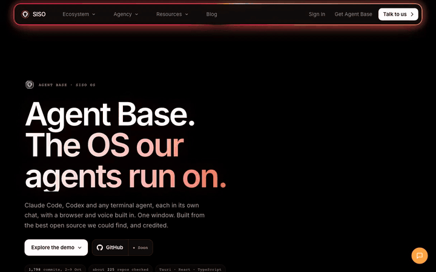

<!-- siso-os:header (generated by sisodias/siso-os-release from repos.json; edit there, not here) -->

  

<h1 align="center">SISO Harness Lab</h1>

<b>Measure and tune a Claude Code and Codex setup for context, cost and speed, with the tools that came out of it.</b>

  
  
  
  

  

  <a href="https://www.sisolabs.space/agent-base/"><b>Website</b></a> · <a href="https://docs.sisolabs.space">Docs</a> · <a href="https://github.com/siso-os">Every SISO OS project</a>

<!-- /siso-os:header -->
The long-running project to make Shaan's Claude Code and Codex agent setup produce more useful work per token. Evidence, decisions, backlog, and measurement tools. The setup itself lives in `~/.claude`, `~/.codex`, and `SISO_Agents/siso-harness-lab/brain`.

Agents: read `AGENTS.md`. Humans: `STATE.md` says what is true now, `BACKLOG.md` what is next, `DECISIONS.md` what has been ruled.

For a usable project entry, run `npm run project:status` (JSON) or
`npm run project:serve` and open `http://127.0.0.1:8947`. The local page reads the
same backlog, immutable receipts, qualified reviews and connection metadata;
it does not start agents or install skills. See [the system map](docs/SYSTEM-MAP.md).

## Current operation

Shaan's September 12 direction is to reduce repeated analysis/reviews and finish
more requested work. Start with [the operating contract](docs/ECONOMICAL-OPERATION.md)
and [current handoff](.agents/HANDOFF.md). Use the prior experiments when relevant;
do not rerun them or stop for a historical signoff on a new authorized task.

## Earlier owner signoff

PR #1 is merged into canonical private `main`. Read the
[final human report](reports/2026-09-08-owner-signoff.md) for achievements, checks,
local UI truth, one-shot Luna continuation and remaining gaps. Its review checkpoint
is historical; the current user assignment and handoff determine the work now.

## Recursive efficiency improvement

Start at [.agents/PAGE.md](.agents/PAGE.md). The executable, dependency-free
experiment loop is `npm run loop:next` → improve one candidate → `npm test` →
`npm run loop:cycle` → record the lesson and continue. Run on Node.js 20+;
`npm test` also uses Python 3's standard library for isolated audit regressions.

[Web UI pickup](docs/WEB-UI-PICKUP.md) is the ready-to-use assignment for an agent
with this private GitHub repository attached. [The loop contract](docs/IMPROVEMENT-LOOP.md)
defines evidence, counterexamples, held-out checks, rollback and continuation.
The Web UI agent does the reasoning; the runner evaluates and records experiments.
There is no hidden model service, paid API requirement or scheduled worker.

Contains no credentials, transcripts, or generated state. Reports quote paths and numbers, not payloads.